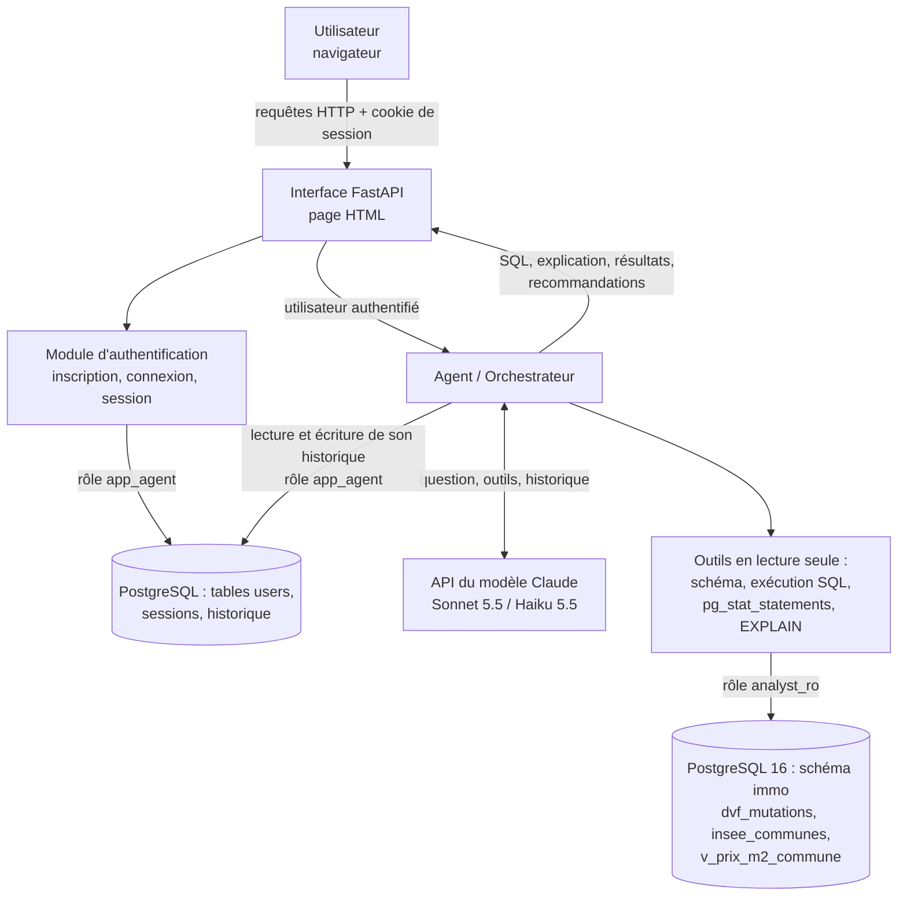

# Fiche de cadrage du projet

**Cours** : Développement et déploiement d'applications intelligentes **Projet d'agent IA en binôme**

> **Consignes générales**

> - Remplissez chaque section de ce document. Les consignes en italique indiquent ce qui est attendu.  
> - Nommez le fichier selon la convention : `NomBinome_ProjetXX.md` (exemple : `Larhlimi-Benali_Projet07.md`).  
> - Le document est à remettre avec le dataset (fichier CSV joint ou lien fonctionnel) et la maquette.  
> - Les réponses courtes ou de type oui/non ne sont pas acceptées dans le questionnaire de la section 8\.

---

## 1\. Identification du binôme

*Indiquez les informations de chaque membre. Le groupe correspond à votre section de cours.*

|  | Membre 1 | Membre 2 |
| :---- | :---- | :---- |
| Nom | Bellaly | Atata |
| Prénom | Sara | Douaa |
| Adresse courriel | bellalysara@gmail.com | atatadouaa0@gmail.com |
| Groupe / Section | 5IADO G1 | 5IADO G1 |

---

## 2\. Projet choisi

*Reportez le numéro et l'intitulé exact du projet tel qu'il apparaît dans la liste des 40 projets (`projets-agents-ia.md`).*

- **Numéro du projet** : 11  
- **Intitulé du projet** : Agent de gestion de base de données  
- **Type** : ☒ Informatique (1 à 20\)  ☐ Industriel (21 à 40\)  
- **Catégorie** (ex. : Sécurité, Génie logiciel, Maintenance industrielle) : Données

*Intitulé et catégorie vérifiés dans la liste officielle fournie (fichier `projets-agents-ia.xlsx`, ligne 11 : « Agent de gestion de base de données », catégorie « Données », niveau « Intermédiaire »).*

---

## 3\. Descriptif proposé

*Entre 150 et 300 mots. Décrivez le problème à résoudre, les utilisateurs cibles, les fonctionnalités principales de l'agent et le périmètre retenu pour le cours. Soyez précis sur ce qui sera réalisé et sur ce qui ne le sera pas.*

**Problème à résoudre**

Sur une base PostgreSQL volumineuse, repérer les requêtes coûteuses, lire leurs plans d'exécution et choisir le bon index demande une expertise de DBA. Dans notre base (3 793 113 lignes de transactions immobilières), une vue de prix au m² prend de 5 à 55 s selon l'état du cache ; sa version matérialisée, créée à la main après analyse, répond en moins de 2 ms. Les utilisateurs métier, eux, ne savent pas écrire le SQL qui répond à leurs questions.

**Utilisateurs cibles**

Les développeurs et DBA PostgreSQL, et les analystes du marché immobilier. Chacun se connecte à son propre compte.

**Fonctionnalités principales de l'agent**

1\. Collecter les requêtes les plus coûteuses (`pg_stat_statements`).  
2\. Expliquer leurs plans `EXPLAIN`, en lecture seule.  
3\. Proposer des index ou des réécritures, jamais appliqués automatiquement.  
4\. Traduire une question métier en SQL, validé avant exécution en lecture seule.  
5\. Conserver l'historique personnel des questions et réponses de chaque utilisateur.

**Périmètre retenu pour le cours**

| Inclus dans le projet | Exclu du projet (hors périmètre) |
| :---- | :---- |
| Inscription et connexion par email et mot de passe haché (argon2id) ; blocage de 15 minutes après 5 échecs | Réinitialisation du mot de passe par email ; vérification de l'adresse email |
| Session de 8 heures par cookie HttpOnly et SameSite ; déconnexion manuelle qui l'invalide | Rôle administrateur ; connexion par un fournisseur tiers (Google, GitHub) |
| Historique par utilisateur, visible de lui seul ; suppression du compte avec son historique | Toute modification de structure sans validation humaine |
| Collecte des requêtes lentes ; analyse des plans `EXPLAIN` en lecture seule ; recommandations d'index non appliquées | Modèles de prévision ; sources autres que DVF et INSEE |
| Traduction de questions métier en une seule instruction `SELECT`, vérifiée puis validée avant exécution, pour trois types de questions : prix au m² et ventes par commune ou année ; nombre de transactions par commune, période ou type de bien ; top N de communes avec filtre de population | |

---

## 4\. Dataset

*Indiquez le jeu de données que l'agent utilisera (documents, logs, tickets, mesures capteurs, etc.). Joignez le fichier CSV ou fournissez un lien fonctionnel. Si les données sont générées ou simulées, expliquez la méthode de génération.*

| Élément | Réponse |
| :---- | :---- |
| Nom du fichier CSV joint ou lien | CSV non joint : il est trop volumineux (731 194 611 octets décompressé). Liens :<br>• DVF géolocalisé : https://www.data.gouv.fr/datasets/demandes-de-valeurs-foncieres-geolocalisees (ressource « DVF 2025 », fichier `full-2025.csv.gz`, obtenue par l'API data.gouv.fr, jeu de données `5cc1b94a634f4165e96436c1`)<br>• COG INSEE 2026 : https://www.insee.fr/fr/information/2560452 (fichier https://www.insee.fr/fr/statistiques/fichier/8740222/v_commune_2026.csv)<br>• Populations de référence 2023 (INSEE) : https://www.insee.fr/fr/statistiques/8680726?sommaire=8681011 (fichier `ensemble.zip`)<br>Procédure complète de téléchargement : `INSTALL.md` et `docs/sources.md` du dépôt https://github.com/SaraBellaly/DataAgent |
| Source (site, organisme, génération propre) | data.gouv.fr (DVF géolocalisé, Etalab) et INSEE (Code officiel géographique 2026, populations de référence 2023) |
| Taille approximative (lignes, colonnes, Mo) | • DVF 2025 : 3 793 113 lignes, 40 colonnes ; 116 Mo compressé (116 267 867 octets), environ 700 Mo décompressé (731 194 611 octets) ; 1,6 Go une fois chargé dans PostgreSQL<br>• COG 2026 : 37 496 lignes dans le fichier, dont 34 920 retenues (34 875 communes et 45 arrondissements municipaux de Paris, Lyon et Marseille) ; 12 colonnes ; 3 565 935 octets<br>• Populations 2023 : 34 900 communes ; 11 colonnes ; `donnees_communes.csv`, 2 167 955 octets |
| Licence ou conditions d'utilisation | • DVF géolocalisé : **Licence Ouverte / Open Licence version 2.0** (Etalab) : https://www.data.gouv.fr/pages/legal/licences/etalab-2-0<br>• Populations de référence (INSEE) : **Licence Ouverte / Open Licence version 2.0 (Etalab)**. Source : INSEE, fichier d'ensemble 2023, téléchargé sur https://www.insee.fr/fr/statistiques/8680726.<br>• Code officiel géographique (INSEE) : **Licence Ouverte / Open Licence version 2.0 (Etalab)**. Source : INSEE, fichier `v_commune_2026.csv`, téléchargé depuis https://www.insee.fr/fr/information/8740222.<br>Pour ces deux fichiers, les pages de téléchargement n'indiquent pas de licence particulière. S'applique donc la clause générale des mentions légales de l'INSEE (https://www.insee.fr/fr/information/2008466), citée mot pour mot : « Sauf mention contraire, les informations publiques diffusées sur ce site (données, bases de données, publications, fichiers téléchargeables) sont mises à disposition sous la Licence Ouverte / Open Licence version 2.0 (Etalab). Cette licence autorise la réutilisation libre, y compris à des fins commerciales, sous réserve de mentionner la source sous la forme « Source : Insee », de mentionner la date de dernière mise à jour des données lorsque celle-ci est connue et de ne pas altérer le sens des informations ou induire en erreur quant à leur interprétation. »<br>La licence de DVF est celle déclarée sur sa fiche data.gouv.fr. Les trois licences ont été relevées le 14/11/2026 ; toutes imposent de mentionner la source et la date de dernière mise à jour des données. |
| Format des données (CSV, JSON, PDF, logs, images) | CSV : DVF séparé par des virgules ; COG séparé par des virgules, valeurs entre guillemets ; populations séparées par des points-virgules (dans un zip). Encodage UTF-8. Les données sont chargées dans PostgreSQL 16 (schéma `immo`). |

**Description des colonnes ou champs principaux**

Colonnes principales des deux tables, tirées de `sql/02_schema.sql`. Les exemples sont des valeurs réelles du jeu chargé.

| Colonne / Champ | Type | Description | Exemple de valeur |
| :---- | :---- | :---- | :---- |
| `dvf_mutations.id` | bigserial (clé primaire) | Clé technique ; `id_mutation` n'est pas unique | 3793114 |
| `dvf_mutations.id_mutation` | text | Identifiant de la mutation (une mutation peut couvrir plusieurs lignes) | `2025-1` |
| `dvf_mutations.date_mutation` | date | Date de la vente | `2025-01-07` |
| `dvf_mutations.nature_mutation` | text | Nature de la mutation | `Vente` |
| `dvf_mutations.valeur_fonciere` | numeric(15,2) | Prix en euros, répété sur toutes les lignes de la mutation ; 50 484 valeurs nulles | `468000.00` |
| `dvf_mutations.code_commune` | text | Code commune INSEE (5 caractères, zéros en tête, `2A`/`2B` pour la Corse) ; clé de jointure, indexée | `01158` |
| `dvf_mutations.nom_commune` | text | Nom de la commune dans DVF | `Farges` |
| `dvf_mutations.type_local` | text | Type de local ; NULL pour les lignes sans local | `Appartement`, `Maison`, `Dépendance` |
| `dvf_mutations.surface_reelle_bati` | integer | Surface bâtie en m² (peut valoir 0) | `0` |
| `dvf_mutations.nombre_pieces_principales` | smallint | Nombre de pièces principales | `0` |
| `dvf_mutations.lot1_surface_carrez` | numeric(10,2) | Surface Carrez du premier lot (lots 1 à 5) | `35.74` |
| `dvf_mutations.longitude`, `latitude` | double precision | Coordonnées géographiques | `5.907192`, `46.17086538221288` |
| `insee_communes.code_insee` | text (clé primaire) | Code commune INSEE | `75101` |
| `insee_communes.typecom` | text | `COM` (commune) ou `ARM` (arrondissement municipal) | `ARM` |
| `insee_communes.libelle` | text | Nom officiel avec article | `Paris 1er Arrondissement` |
| `insee_communes.dep`, `reg` | text | Codes département et région | `75`, `11` |
| `insee_communes.comparent` | text | Commune parente d'un arrondissement | `75056` |
| `insee_communes.pmun` | integer | Population municipale 2023 (indicateur principal) | `15114` |
| `insee_communes.ptot` | integer | Population totale 2023 | `15207` |

La table `dvf_mutations` compte 41 colonnes (les 40 du fichier, plus la clé technique) et `insee_communes` 14 colonnes. Le détail figure dans `sql/02_schema.sql`.

**Si les données sont générées ou simulées, décrivez la méthode :**

Sans objet : les données sont **réelles**, et aucune n'est générée ni simulée. Elles sont chargées telles quelles par `COPY` dans des tables de transit, puis converties et insérées dans des tables typées, sans aucune correction des valeurs. Les écarts connus, comme les codes communes absents du référentiel, sont documentés et listés par le script de vérification, sans être corrigés.

---

## 5\. Proposition de maquette

*Décrivez l'interface ou le flux d'interaction avec l'agent : écrans, entrées de l'utilisateur, sorties de l'agent. Joignez un schéma ou un lien vers une maquette (Figma, image, dessin scanné). Ajoutez également un schéma d'architecture simplifié de l'agent.*

### 5.1 Interface et flux d'interaction

**Type d'interface** : ☒ Application web  ☐ Interface en ligne de commande  ☐ API  ☐ Chatbot (Slack, Teams, etc.)  ☐ Tableau de bord  ☐ Autre :

Application web minimale servie par FastAPI, avec quatre écrans : inscription, connexion, question (saisie, réponse avec SQL, résultats) et historique personnel. Les écrans « question » et « historique » ne sont accessibles qu'à un utilisateur connecté.

**Écrans ou étapes principales**

| Écran / Étape | Ce que l'utilisateur fait (entrée) | Ce que l'agent renvoie (sortie) |
| :---- | :---- | :---- |
| 1\. Inscription | Il saisit son adresse email et un mot de passe. Aucune autre donnée n'est demandée. | L'application crée le compte, avec le mot de passe haché (argon2id), puis redirige vers la connexion. Si l'adresse est déjà utilisée, elle affiche un message. |
| 2\. Connexion | Il saisit son email et son mot de passe ; il peut se déconnecter à tout moment. | Si les identifiants sont corrects, l'application ouvre une session et pose un cookie `HttpOnly` et `SameSite`, puis affiche l'écran Question. Sinon, elle affiche un message d'erreur qui ne dit pas si c'est l'email ou le mot de passe qui est faux. La déconnexion invalide la session côté serveur. |
| 3\. Question | Il tape une question en français, par exemple « Quelles sont les communes les plus chères au m² pour les appartements en 2025 ? » ou « Quelles sont les requêtes les plus lentes ? ». Il relit le SQL proposé, valide l'exécution et peut afficher le plan d'exécution. | Le SQL proposé, une explication en français, puis, après validation, le tableau de résultats (exécution en lecture seule) et, en option, le plan `EXPLAIN`. Si la requête est lente, l'agent ajoute un diagnostic, par exemple « la vue recalcule l'agrégat sur 3,8 millions de lignes à chaque appel ». Il propose aussi des index ou des réécritures, présentés comme des suggestions à valider, **jamais appliqués automatiquement**. L'échange est enregistré dans l'historique de l'utilisateur. |
| 4\. Historique personnel | Il consulte la liste de ses questions passées et peut en rouvrir une. Deux actions sont proposées : « Se déconnecter » et « Supprimer mon compte ». | Ses seules questions et réponses : SQL, explication, date. L'historique d'un autre utilisateur n'est jamais accessible. « Se déconnecter » invalide la session et ramène à l'écran de connexion. « Supprimer mon compte » ouvre une **demande de confirmation**. Si l'utilisateur confirme, le compte, toutes ses sessions et tout son historique sont supprimés, puis il est ramené à l'écran d'inscription. S'il annule, rien n'est modifié. |

Esquisse de l'écran Question (maquette textuelle) :

```
+--------------------------------------------------------------------------+
| Agent de gestion de base de données     [Historique]  [Se déconnecter]  |
+--------------------------------------------------------------------------+
| Votre question : [ Quelles sont les communes les plus chères au m² ? ]  |
|                                                          [ Envoyer ]    |
+--------------------------------------------------------------------------+
| SQL proposé :                                                            |
|   SELECT code_commune, nom_commune, nb_ventes, prix_m2_moyen            |
|   FROM v_prix_m2_commune WHERE annee = 2025 AND nb_ventes >= 100 ...    |
| Explication : ...                       [ Valider et exécuter ]         |
+--------------------------------------------------------------------------+
| Résultats :  code_commune | nom_commune             | nb_ventes | prix  |
|              75106        | Paris 6e Arrondissement |       327 | 13893 |
+--------------------------------------------------------------------------+
| [+] Plan d'exécution (EXPLAIN)       [+] Recommandations (à valider)    |
+--------------------------------------------------------------------------+
```

Esquisse de l'écran Historique personnel (maquette textuelle) :

```
+--------------------------------------------------------------------------+
| Mon historique                [Question]  [Se déconnecter]              |
+--------------------------------------------------------------------------+
| Date        | Question                                      |           |
| ...         | Quel est le prix moyen au m² des appartements | [Rouvrir] |
|             | à Bordeaux en 2025 ?                          |           |
| ...         | et Toulouse ?                                 | [Rouvrir] |
+--------------------------------------------------------------------------+
|                                               [Supprimer mon compte]    |
+--------------------------------------------------------------------------+

Après clic sur « Supprimer mon compte » :
+--------------------------------------------------------------------------+
| Supprimer définitivement votre compte, vos sessions et tout votre       |
| historique ? Cette action est irréversible.                              |
|                                  [Annuler]  [Confirmer la suppression]  |
+--------------------------------------------------------------------------+
```

**Lien ou fichier de la maquette** : `maquette/index.html`, dans le dépôt du projet, présente les quatre écrans (inscription, connexion, question, historique). C'est une maquette de cadrage, statique : elle n'exécute aucune requête et n'envoie aucune donnée. Elle s'ouvre directement dans un navigateur, et les résultats affichés sur l'écran Question sont des valeurs réelles de la base. Elle complète les esquisses textuelles ci-dessus.

### 5.2 Schéma d'architecture de l'agent

*Représentez les composants principaux : utilisateur, orchestrateur ou agent, LLM, outils appelés, base de données ou base vectorielle, sources de données. Vous pouvez utiliser un bloc Mermaid, un schéma ASCII ou une image.*



&nbsp;

**Explication du schéma**

L'utilisateur se connecte depuis son navigateur à l'interface FastAPI. Le module d'authentification vérifie l'email et le mot de passe haché, ouvre une session et pose un cookie `HttpOnly` et `SameSite`. Il lit et écrit les tables `users` et `sessions` avec le rôle `app_agent`. Une fois l'utilisateur authentifié, sa question est transmise à l'agent (l'orchestrateur). L'agent l'envoie à l'API du modèle Claude, avec la description des outils et l'historique récent de **cet utilisateur seulement**. Le modèle choisit l'outil à appeler, l'agent exécute l'appel et lui renvoie le résultat, jusqu'à la réponse finale. Les outils accèdent aux données métier avec le rôle `analyst_ro`. Ce rôle est en lecture seule, limité à 30 s par requête, sans aucun droit d'écriture ni de création (vérifié par `scripts/verify.ps1` : 38 contrôles OK). Il n'a aucun accès aux tables d'authentification et d'historique. Seul `app_agent` y écrit, et toujours avec l'identifiant de l'utilisateur tiré de la session. Toute requête générée est validée avant exécution, et toute recommandation d'index reste une suggestion. Il n'y a pas de base vectorielle.

---

## 6\. Technologies et outils

*Complétez les deux tableaux. Chaque ligne doit comporter une justification courte du choix. Les deux volets (développement et déploiement) sont obligatoires.*

### 6.1 Développement

| Catégorie | Outil ou technologie choisi | Justification du choix |
| :---- | :---- | :---- |
| Langage de programmation | Python | Langage de référence pour les API de modèles de langage, avec un pilote PostgreSQL mature (psycopg) et pytest pour les tests. |
| Framework d'agents (LangChain, LlamaIndex, CrewAI, AutoGen, etc.) | Aucun framework d'agent : appel d'outils direct avec le SDK Python officiel d'Anthropic (`anthropic`) | L'agent n'a que quatre outils et une boucle simple. Un appel direct garde le contrôle total sur ce qui est exécuté (lecture seule, validation avant exécution) et évite une couche d'abstraction supplémentaire. |
| Framework web | FastAPI, avec une page HTML servie par l'application | Framework Python léger : les routes d'inscription, de connexion, de question et d'historique, ainsi que la page HTML, tiennent dans une seule application. Il valide les entrées des formulaires et s'intègre directement au code de l'agent, dans le même langage. |
| Authentification | Mots de passe hachés avec argon2id (bibliothèque argon2-cffi) ; cookie de session `HttpOnly` et `SameSite=Strict`, invalidé à la déconnexion | argon2id est une fonction de hachage conçue pour les mots de passe : lente, avec sel, et résistante aux attaques par force brute, contrairement à SHA-256. Nous l'avons préférée à bcrypt, qui tronque les mots de passe à 72 octets. Le cookie `HttpOnly` n'est pas lisible par JavaScript, ce qui limite le vol de session par injection de script. `SameSite` limite les requêtes intersites forgées (CSRF). La session est enregistrée côté serveur (table `sessions`, qui ne conserve que l'empreinte SHA-256 du jeton) pour pouvoir être invalidée à la déconnexion. Elle dure 8 heures, et après 5 échecs de connexion, l'accès est bloqué pendant 15 minutes. |
| Modèle LLM (fournisseur et modèle) | Claude (Anthropic) : **Claude Sonnet 5.5** (`claude-sonnet-5-5`) en production, **Claude Haiku 5.5** (`claude-haiku-5-5`) pour les tests de développement. Le nom du modèle est lu dans une variable de configuration (`.env`). | Sonnet 5.5 offre le niveau de raisonnement nécessaire pour lire un plan `EXPLAIN` et écrire un SQL correct, avec l'appel d'outils natif. Haiku 5.5, bien moins cher, suffit pour vérifier la mécanique (appels d'outils, enchaînement, interface) pendant le développement. La variable de configuration permet de changer de modèle sans modifier le code. **Coût à l'usage**, selon les tarifs publiés par Anthropic (référence du 3 novembre 2026, à revérifier) : Sonnet 5.5 à 2 $ par million de tokens en entrée et 10 $ en sortie ; Haiku 5.5 à 0,10 $ et 0,50 $ (requêtes jusqu'à 100 000 tokens). |
| Base vectorielle (si RAG) | Aucune | Les données sont structurées et interrogées en SQL. Le schéma, environ 55 colonnes réparties sur deux tables et une vue, est lu directement par un outil plutôt que par recherche vectorielle. |
| Mémoire de l'agent | Historique persistant par utilisateur, dans PostgreSQL (table `historique`), en remplacement de la mémoire de session seule | Chaque utilisateur retrouve ses échanges d'une session à l'autre, et l'agent reçoit comme contexte les échanges récents de cet utilisateur seulement. Le stockage en base évite un composant supplémentaire et permet de cloisonner les données par utilisateur. |
| Bibliothèques principales | psycopg 3 et psycopg-pool (PostgreSQL) ; FastAPI et uvicorn ; pydantic, pydantic-settings et email-validator ; argon2-cffi ; `anthropic` (SDK officiel, pour l'agent). Versions figées dans `backend/requirements.txt`. | psycopg : pilote PostgreSQL standard, qui permet des requêtes paramétrées ; psycopg-pool garde un pool de connexions par rôle (`analyst_ro`, `app_agent`). uvicorn : serveur de l'application FastAPI. pydantic : validation des entrées (email valide, longueur du mot de passe, aucun champ en trop) et lecture de la configuration depuis `.env`. argon2-cffi : hachage des mots de passe. `anthropic` : client officiel de l'API Claude. |
| Outils de test | pytest (tests d'intégration sur la base réelle) ; script de vérification `scripts/verify.ps1` | pytest est l'outil de test standard en Python. 31 tests couvrent déjà l'authentification et le cloisonnement : inscription, connexion, blocage après 5 échecs, déconnexion, session expirée, accès croisé à l'historique entre deux comptes, suppression du compte, séparation des deux rôles. `verify.ps1` contrôle les données et les droits des rôles (38 contrôles, dont 17 tentatives réelles d'opérations interdites sous `analyst_ro` : écriture, création, lecture de fichiers serveur ; toutes refusées). |
| Gestion de version (Git, plateforme) | Git et GitHub (https://github.com/SaraBellaly/DataAgent) | Le dépôt existe déjà. `.env` et les données brutes (`data/raw/`) en sont exclus par `.gitignore`, et aucun secret n'est versionné. |

### 6.2 Déploiement

| Catégorie | Outil ou technologie choisi | Justification du choix |
| :---- | :---- | :---- |
| Conteneurisation (Docker, etc.) | Docker et Docker Compose : PostgreSQL 16 et l'application FastAPI (service `backend`, déjà en place pour l'authentification) ; l'agent et les écrans s'y ajouteront (calendrier, section 7) | La base démarre déjà par `docker compose`, avec `pg_stat_statements` activé et `init: true`. L'installation est reproductible (procédure complète dans `INSTALL.md`). |
| Hébergement (cloud, serveur, local) | Local (poste de développement) : application sur `127.0.0.1:8000` (variable `APP_PORT`) ; hébergement cible [À VALIDER] | La base et l'application ne sont exposées que sur `127.0.0.1`. Le projet est conçu pour être évalué sur une machine locale. |
| CI/CD | [À VALIDER] | Aucune chaîne CI/CD n'est en place à ce jour. |
| Monitoring et journalisation | `pg_stat_statements` et journaux PostgreSQL (`docker compose logs db`) ; journalisation de l'agent [À VALIDER] | `pg_stat_statements` mesure déjà le temps cumulé et le nombre d'appels de chaque requête ; c'est aussi une source de données de l'agent. |
| Gestion des secrets et clés API | Clé de l'API du modèle et mots de passe des rôles (`ANALYST_RO_PASSWORD`, `APP_AGENT_PASSWORD`…) lus depuis `.env`, jamais commité ; `.env` exclu du suivi Git. Mots de passe de la base transmis aux scripts par variable d'environnement (`PGPASSWORD`). | Aucun mot de passe n'est écrit dans le code (vérifié avant chaque commit). Les connexions exigent un mot de passe (`scram-sha-256`). |
| Rôles de base de données | `analyst_ro` pour l'agent, en lecture seule sur les données métier (déjà en place) ; `app_agent` pour l'application, avec écriture limitée aux tables `users`, `sessions` et `historique` (en place : `sql/01_roles.sql` et `sql/06_app_schema.sql`) | **Séparer les deux rôles cloisonne les risques.** Le SQL généré par le modèle s'exécute avec `analyst_ro`, qui ne peut rien écrire et ne voit ni les comptes, ni les mots de passe hachés, ni les historiques : même une requête malveillante ou erronée ne peut ni les lire ni les modifier. `app_agent` n'exécute que les requêtes écrites par nous, paramétrées, et n'a aucun droit sur les données métier ni sur leur structure. Une faille d'un côté ne donne donc pas accès à l'autre. |
| Exposition de l'application (API, interface web) | Application FastAPI servant une page HTML, avec quatre écrans (inscription, connexion, question, historique) | Une seule application sert à la fois les pages et les routes ; l'accès aux écrans Question et Historique exige une session valide. |

---

## 7\. Répartition des tâches et calendrier

*Indiquez qui fait quoi et les principales étapes jusqu'à la remise finale.*

| Étape | Responsable (Membre 1 / Membre 2 / Les deux) | Date de début | Date de fin | Livrable |
| :---- | :---- | :---- | :---- | :---- |
| Cadrage et choix des données | Les deux | 13/11/2026 | 14/11/2026 | Fiche de cadrage |
| Préparation du dataset | Sara Bellaly | 13/11/2026 | 14/11/2026 | Base chargée, vérification, INSTALL.md (réalisé) |
| Authentification, sessions et rôle app_agent | Sara Bellaly | 15/11/2026 | 20/11/2026 | Inscription, connexion, sessions, historique cloisonné (réalisé, 31 tests) |
| Cœur de l'agent : collecte, analyse des plans, recommandations | Sara Bellaly | 21/11/2026 | 28/11/2026 | Modules Python testés |
| Cœur de l'agent : traduction question vers SQL | Douaa Atata | 21/11/2026 | 28/11/2026 | Module NL vers SQL et jeu d'exemples |
| Interface utilisateur (écrans, saisie, résultats, historique) | Douaa Atata | 25/11/2026 | 01/12/2026 | Application FastAPI et pages web |
| Intégration des outils et de la mémoire | Les deux | 29/11/2026 | 01/12/2026 | Agent complet |
| Tests et évaluation (jeu de 10 à 15 requêtes) | Sara Bellaly | 02/12/2026 | 03/12/2026 | Tests et tableau de résultats |
| Conteneurisation et déploiement | Douaa Atata | 02/12/2026 | 03/12/2026 | Docker Compose complet |
| Documentation et présentation | Les deux | 03/12/2026 | 04/12/2026 | Dossier de remise |

*Remise finale : vendredi 04/12/2026. Membre 1 : Sara Bellaly ; Membre 2 : Douaa Atata.*

---

## 8\. Questionnaire de cadrage

*Répondez à chacune des 15 questions de façon détaillée (plusieurs phrases par réponse). Ces réponses serviront de base à l'évaluation de la compréhension du projet.*

### Compréhension du besoin

**Q1. Quel problème concret votre agent résout-il, et comment ce problème est-il traité aujourd'hui sans agent IA ?**

L'agent aide à comprendre pourquoi une requête SQL est lente et à y remédier sans risque pour la base. Notre base en donne un exemple mesuré. La vue `v_prix_m2_commune` prend entre 5 s (données déjà en cache, mesure du 19/11/2026) et 55 s (premier accès) selon la requête. Le top 10 des communes les plus chères a été annulé une fois à 31,1 s par la limite de 30 s du rôle `analyst_ro`. À l'inverse, une requête sur une seule commune utilise l'index `dvf_mutations_code_commune_idx` et répond en environ 0,1 s. Aujourd'hui, sans agent, un DBA ou un développeur doit trouver lui-même les requêtes coûteuses dans `pg_stat_statements`, lancer `EXPLAIN (ANALYZE, BUFFERS)`, interpréter le plan (par exemple un « Parallel Seq Scan » sur un filtre de date sans index), puis décider d'un index. C'est ce que nous avons fait à la main pendant la préparation des données : le plan montrait que la vue regroupe les 3,8 millions de lignes avant tout filtre. Nous en avons tiré une vue matérialisée indexée, `v_prix_m2_commune_mat`, qui répond en moins de 2 ms ; ce cas réel servira à évaluer les diagnostics de l'agent. Le second volet du problème, la traduction de questions métier en SQL, est aujourd'hui traité par un développeur qui écrit chaque requête à la demande.

**Q2. Qui est l'utilisateur final de votre agent, et comment interagit-il avec lui au quotidien ?**

Nous visons deux profils. Le premier est le développeur ou le DBA qui maintient la base PostgreSQL. Il demande par exemple « Quelles sont les requêtes les plus coûteuses ? » ou « Pourquoi cette requête est-elle lente ? », et attend un diagnostic appuyé sur le plan d'exécution. Le second est l'analyste métier du marché immobilier : il pose une question en français, comme « Quel est le prix moyen au m² des appartements à Bordeaux en 2025 ? », sans écrire de SQL. Dans les deux cas, l'interaction passe par l'application web FastAPI, qui compte quatre écrans : inscription, connexion, question et historique. L'utilisateur crée une fois son compte (email et mot de passe), puis se connecte ; sa session dure 8 heures. Sur l'écran Question, il tape sa question, relit le SQL proposé et son explication, valide l'exécution, puis consulte le tableau de résultats et, s'il le souhaite, le plan `EXPLAIN` et les recommandations. Le lendemain, il retrouve ses échanges sur l'écran Historique, et l'agent s'en sert comme contexte pour les questions suivantes. L'utilisateur reste décisionnaire : aucune requête n'est exécutée et aucun index n'est créé sans son accord.

**Q3. Quelle valeur ajoutée apporte l'agent par rapport à une solution classique (script, règles fixes, recherche manuelle) ?**

Un script peut lister les requêtes les plus lentes de `pg_stat_statements`, mais il n'explique pas leur lenteur ni la façon d'y remédier. L'agent relie le plan d'exécution au schéma réel et formule un diagnostic compréhensible. Par exemple : la vue regroupe d'abord les 3,8 millions de lignes par mutation, donc un filtre sur une commune ne peut pas être appliqué avant ce regroupement, d'où une durée identique quelle que soit la commune. Des règles fixes, comme « ajouter un index sur toute colonne filtrée », proposeraient un index sur `date_mutation`. Elles ne verraient pas que le vrai coût de la vue vient de l'agrégation, pour laquelle une vue matérialisée ou une réécriture seraient plus adaptées. Pour la traduction en SQL, l'agent connaît les particularités des données : par exemple, la valeur foncière est répétée sur toutes les lignes d'une même mutation. Un utilisateur qui écrit son SQL à la main risque d'en faire la somme, et donc de compter plusieurs fois le même prix. Enfin, l'agent garde les garde-fous d'une démarche manuelle prudente : lecture seule, validation humaine, aucune modification de structure.

### Raisonnement et comportement de l'agent

**Q4. Quelles sont les entrées de l'agent et quelles sorties produit-il ? Donnez un exemple complet d'interaction.**

**Entrées** : une question en français, saisie par un utilisateur connecté, et les échanges récents de **cet** utilisateur, relus dans la table `historique` et fournis comme contexte. L'agent dispose aussi de ce que ses outils lui renvoient : le schéma de la base, les statistiques de `pg_stat_statements`, les plans `EXPLAIN` et les résultats des requêtes en lecture seule.

**Sorties** : un SQL proposé (une seule instruction `SELECT`), une explication en français, le tableau de résultats après validation et, si besoin, des recommandations d'index ou de réécriture. L'application enregistre ensuite l'échange dans l'historique de l'utilisateur.

**Exemple complet**, construit avec des résultats réels de notre base :

1. **Inscription** : l'utilisateur saisit son email et un mot de passe. Le compte est créé, avec le mot de passe haché (argon2id).
2. **Connexion** : il se connecte. L'application ouvre une session de 8 heures et pose un cookie `HttpOnly` et `SameSite`.
3. **Question** : sur l'écran Question, il demande « Quel est le prix moyen au m² des appartements à Bordeaux en 2025 ? ».
4. **Réponse avec SQL** : l'agent lit le schéma et propose `SELECT nom_commune, nb_ventes, prix_m2_moyen FROM v_prix_m2_commune WHERE code_commune = '33063' AND annee = 2025;`. L'application vérifie qu'il s'agit bien d'une seule instruction `SELECT`. L'agent explique que la vue ne retient que les ventes comportant un seul local de type appartement, avec un prix au m² compris entre 500 et 30 000 €.
5. **Résultats** : l'utilisateur valide. La requête s'exécute avec le rôle `analyst_ro` et renvoie Bordeaux, 1 262 ventes, 4 480 €/m². L'agent signale que la lecture de cette vue prend plusieurs secondes (5 à 55 s), car elle recalcule son agrégat à chaque appel. Il indique que la vue matérialisée `v_prix_m2_commune_mat` donne le même résultat en moins de 2 ms et propose, pour la suite, de l'interroger à la place.
6. **Question de suivi** : l'utilisateur enchaîne avec « et Toulouse ? ». Grâce à l'historique fourni en contexte, l'agent comprend qu'il s'agit de la même question. Il propose la même requête avec le code `31555`, qui renvoie 1 152 ventes à 4 153 €/m².
7. **Historique** : sur l'écran Historique, l'utilisateur retrouve ses deux questions, avec le SQL, l'explication et la date. Il ne voit que les siennes.

**Q5. Quelles décisions l'agent prend-il de façon autonome, et quels outils externes appelle-t-il pour y parvenir (recherche, base de données, exécution de code, API) ?**

L'agent décide seul de l'ordre de ses étapes et des outils à appeler. Il choisit par exemple de lire le schéma avant d'écrire une requête, de demander un `EXPLAIN` pour comprendre une lenteur, ou de consulter `pg_stat_statements` pour trouver les requêtes les plus coûteuses. Il dispose de quatre outils, **tous en lecture seule et tous connectés à PostgreSQL avec le rôle `analyst_ro`** :
- **Lecture du schéma** : tables, colonnes, types et commentaires du schéma `immo` (`dvf_mutations`, `insee_communes`, vue `v_prix_m2_commune`), pour écrire un SQL qui correspond à la base réelle.
- **Exécution SQL** : exécute, après vérification (une seule instruction `SELECT`) et validation par l'utilisateur, la requête proposée, avec la limite de 30 s du rôle.
- **Consultation de `pg_stat_statements`** : renvoie les requêtes les plus coûteuses, avec leur temps cumulé et leur nombre d'appels.
- **Production de plans `EXPLAIN`** : renvoie le plan d'exécution d'une requête, pour diagnostiquer sa lenteur.

`analyst_ro` n'a accès ni aux tables de comptes ni à l'historique. Ceux-ci sont gérés par l'application, avec le rôle séparé `app_agent`, et ne font partie d'aucun outil de l'agent. L'agent appelle aussi l'API du modèle Claude, qui choisit l'outil à chaque étape : `claude-sonnet-5-5` en production et `claude-haiku-5-5` pour les tests de développement, le nom du modèle étant lu dans la configuration. En revanche, deux décisions ne lui appartiennent jamais : l'exécution d'une requête qu'il a générée, qui exige la validation de l'utilisateur, et toute modification de structure (création d'index, de table ou de vue), qui reste une recommandation. Ces limites ne reposent pas seulement sur les instructions données au modèle : `analyst_ro` n'a techniquement aucun droit d'écriture ni de création. Le script de vérification le contrôle par des tentatives réelles : INSERT, UPDATE, DELETE, TRUNCATE, COPY, ALTER, CREATE et DROP, ainsi que la lecture de fichiers du serveur. Toutes sont refusées.

**Q6. Quel type de mémoire votre agent utilise-t-il (contexte de conversation, mémoire à long terme, base vectorielle) et pourquoi ?**

L'agent n'a pas de mémoire à long terme au sens d'un modèle entraîné : le modèle Claude n'apprend rien de nos échanges, et chaque appel à son API part de zéro. Ce qui joue le rôle de mémoire est un **historique persistant, stocké dans PostgreSQL et propre à chaque utilisateur** : la table `historique` enregistre chaque question, le SQL proposé, l'explication et la date, avec l'identifiant de l'utilisateur connecté. À chaque nouvelle question, l'application relit les échanges récents de cet utilisateur et les renvoie à l'agent comme contexte de la conversation. L'utilisateur peut ainsi enchaîner, par exemple « Quel est le prix moyen au m² à Bordeaux ? » puis, le lendemain, « et à Lyon ? », sans tout répéter. Le nombre d'échanges renvoyés au modèle sera borné [À VALIDER : nombre], pour maîtriser la taille du contexte et donc le coût. Nous avons choisi cette solution plutôt que la seule mémoire de session pour trois raisons. Elle survit à la déconnexion. Elle alimente l'écran Historique personnel. Et elle reste cloisonnée par utilisateur, car chaque lecture filtre sur l'identifiant tiré de la session. Nous n'utilisons pas de base vectorielle : les connaissances utiles sont structurées et à jour dans la base. Le schéma est lu par un outil au moment voulu, et l'activité de la base est déjà mémorisée par `pg_stat_statements`.

### Données

**Q7. Décrivez la qualité de vos données : valeurs manquantes, bruit, déséquilibre, biais potentiels. Quelles étapes de préparation sont prévues ?**

Nous avons mesuré la qualité des données avec `scripts/verify.ps1`.
- **Valeurs manquantes** : sur les 3 793 113 lignes DVF, aucune valeur nulle sur `code_commune` ni sur `date_mutation`. En revanche, 50 484 lignes (1,33 %) n'ont pas de `valeur_fonciere`, 1 499 963 (39,54 %) pas de `surface_reelle_bati` et 1 497 725 (39,49 %) pas de `type_local`. Ces deux derniers cas correspondent aux lignes sans local (parcelles de terrain ou lignes de lot).
- **Codes communes** : 5 codes DVF, soit 813 lignes, sont absents du référentiel INSEE. Il s'agit de Saint-Martin (97127) et Saint-Barthélemy (97123), dont le référentiel des collectivités n'est volontairement pas chargé, et de trois codes périmés, identifiés avec le fichier des mouvements de communes de l'INSEE : Vritz (44219) et Freigné (49144), fusionnées en 2018 dans Vallons-de-l'Erdre (44180), et Orée d'Anjou (49069), devenue 49126 le 01/01/2025. Ces 7 ventes datent pourtant de 2025 : DVF garde l'ancien code. Par ailleurs, 20 codes du référentiel n'ont pas de population : Paris, Lyon et Marseille, comptés par arrondissement, et les 17 communes de Mayotte.
- **Bruit et structure** : la valeur foncière est répétée sur toutes les lignes d'une même mutation ; parmi les ventes à un seul local de type appartement, 10 mutations s'étendent sur plusieurs communes. Certains prix au m² sont aberrants : parmi les ventes à un seul local de type appartement, 1 204 ont un prix inférieur à 500 €/m² et 66 un prix supérieur à 30 000 €/m². Ces ventes sont exclues de la vue.
- **Préparation réalisée** : chargement par `COPY` dans des tables de transit en texte, avec vérification de l'en-tête (`HEADER MATCH`). Les données sont ensuite converties dans des types stricts : codes en texte pour garder les zéros de tête et les codes corses, chaînes vides converties en NULL. Des garde-fous empêchent tout rechargement d'une période déjà présente.
- **Ce qui n'est pas fait** : aucune correction automatique ; les écarts sont documentés et listés.

**Q8. Quelles sont les limites de votre dataset, et comment ces limites influencent-elles les résultats attendus de l'agent ?**

- **Une seule année** : le dataset ne couvre que 2025. L'agent ne peut donc pas répondre aux questions d'évolution dans le temps, et doit le dire plutôt qu'inventer une tendance.
- **Une règle de la vue très stricte** : `v_prix_m2_commune` ne retient qu'une vente si elle comporte un seul local, de type appartement. Elle n'en retient que 72 057, sur 4 219 communes. Sont exclues les 323 194 ventes d'appartements accompagnées d'autres locaux, comme une cave ou un parking : environ 80 % des ventes d'appartements. Un prix moyen issu de la vue porte donc sur un sous-ensemble de ventes « simples », et l'agent doit l'indiquer dans son explication.
- **Des écarts de référentiel** : le référentiel communal date de 2026 et les populations de 2023. Les codes absents du référentiel imposent des `LEFT JOIN` pour ne pas perdre de lignes. L'agent doit donc connaître ces particularités, sous peine de produire des requêtes justes en apparence mais incomplètes.
- **La lenteur de certaines requêtes** : avec un temps de 5 à 55 s, certaines requêtes sur la vue d'origine dépassent la limite de 30 s d'`analyst_ro`. La vue matérialisée `v_prix_m2_commune_mat` (moins de 2 ms) supprime ce problème pour le prix au m², mais ses chiffres sont figés jusqu'au prochain `REFRESH MATERIALIZED VIEW`. L'agent doit gérer ces annulations et les expliquer. C'est aussi un terrain d'étude réel pour ses recommandations.
- **Des sources limitées** : seules DVF et INSEE sont utilisées. La densité de population est prévue mais n'est pas encore traitée.

### Architecture et choix techniques

**Q9. Justifiez le choix de votre framework d'agents et de votre modèle LLM. Quelles alternatives avez-vous écartées et pourquoi ?**

**Application web : FastAPI.** Il nous faut une petite application qui serve une page HTML, gère l'inscription, la connexion, les sessions et l'historique, et appelle l'agent écrit en Python. FastAPI le permet dans un seul programme. Il valide les données des formulaires, et il peut attendre la réponse de l'API du modèle, qui prend plusieurs secondes, sans bloquer les autres requêtes. Nous avons écarté deux alternatives :
- **Flask** aurait convenu, mais il demande davantage de code et d'extensions pour la validation des entrées et le fonctionnement asynchrone.
- **Streamlit** est très rapide pour prototyper une interface de données. En revanche, il relance tout le script à chaque interaction, et il ne donne pas la main sur les cookies ni sur les routes HTTP. Or notre authentification repose sur une session côté serveur, avec un cookie `HttpOnly` et `SameSite` invalidé à la déconnexion.

**Agent : aucun framework d'agent.** L'agent n'a que quatre outils et une boucle simple : question, appels d'outils, réponse. Nous appelons directement l'API de Claude avec son appel d'outils natif, via le SDK officiel `anthropic`. Le code reste court et lisible, et surtout il nous laisse un contrôle total sur ce qui est exécuté, ce qui est essentiel pour garantir la validation avant exécution et la lecture seule. Nous avons écarté deux frameworks :
- **LangChain** apporte surtout des abstractions pour le RAG sur documents et les chaînes de traitement. Nous n'en avons pas besoin, et il ajouterait une couche entre le modèle et la base. Il serait alors plus difficile de vérifier exactement quel SQL part vers PostgreSQL.
- **CrewAI** sert à orchestrer plusieurs agents aux rôles différents. Notre projet n'en a qu'un.

**Modèle : Claude Sonnet 5.5 en production, Claude Haiku 5.5 pour les tests de développement.** Sonnet 5.5 (`claude-sonnet-5-5`) a le niveau de raisonnement nécessaire pour lire un plan `EXPLAIN` et écrire un SQL correct sur notre schéma. Haiku 5.5 (`claude-haiku-5-5`), vingt fois moins cher en entrée d'après les tarifs publiés (0,10 $ contre 2 $ par million de tokens), suffit pour tester la mécanique de l'application pendant le développement. Le nom du modèle est lu dans une variable de configuration, ce qui permet de passer de l'un à l'autre sans modifier le code.

**Pas de base vectorielle** : nos données sont structurées et interrogées en SQL.

**Q10. Comment votre architecture gère-t-elle les erreurs (outil indisponible, réponse du LLM incohérente, données manquantes) ?**

- **Base indisponible ou requête trop longue** : les erreurs de PostgreSQL seront renvoyées au modèle sous forme de résultat d'outil, pour qu'il les explique à l'utilisateur au lieu de les masquer. Par exemple, la limite de 30 s d'`analyst_ro` produit l'erreur `canceling statement due to statement timeout`, que nous avons observée sur le top 10 de la vue. L'agent pourra alors proposer une version plus légère de la requête, ou recommander une optimisation à valider.
- **SQL incohérent ou dangereux** : avant d'être proposée à l'exécution, chaque requête générée est analysée. Elle doit contenir **une seule instruction, de type `SELECT`**. Sinon (plusieurs instructions séparées par `;`, `UPDATE`, `DROP`…), elle est refusée, n'est pas exécutée, et l'agent est invité à la corriger. Une colonne inventée provoque une erreur de PostgreSQL, que le modèle peut corriger après avoir relu le schéma. Si une écriture passait malgré tout, elle serait refusée par les droits du rôle (`permission denied` ou `read-only transaction`), ce que le script de vérification contrôle en conditions réelles.
- **Validation humaine** : chaque requête générée est présentée avant exécution, ce qui permet d'écarter une requête inattendue.
- **Données manquantes** : codes absents du référentiel, populations nulles, valeurs foncières nulles. L'agent s'appuie sur la documentation du schéma (`COMMENT ON` des tables et colonnes) pour les signaler dans sa réponse.
- **Indisponibilité de l'API du modèle** : en cas d'erreur de l'API de Claude (service indisponible, délai dépassé, quota atteint), l'application affiche un **message d'erreur clair**, par exemple « Le service d'analyse est momentanément indisponible, réessayez plus tard ». Elle **n'invente aucune réponse** : aucun SQL ni aucun résultat n'est affiché sans réponse effective du modèle. L'**historique n'est pas modifié** : l'échange en échec n'y est pas enregistré. La base, les scripts et l'écran Historique restent utilisables.
- **Session expirée ou invalide** : une session dure 8 heures, et l'utilisateur peut y mettre fin à tout moment en se déconnectant. Toute requête vers l'écran Question ou Historique vérifie d'abord la session côté serveur. Si le cookie est absent, expiré ou ne correspond à aucune session en base (par exemple après une déconnexion), l'application ne transmet rien à l'agent. Elle redirige vers l'écran de connexion avec un message clair, et aucun échange n'est enregistré dans l'historique.
- **Mot de passe incorrect** : l'application répond par un message unique, « email ou mot de passe incorrect », pour ne pas révéler si un compte existe pour cette adresse. Le mot de passe saisi est comparé au haché stocké par la fonction de vérification d'argon2id ; il n'est jamais journalisé. Si l'email est inconnu, une vérification factice est faite quand même, pour que le temps de réponse ne révèle pas l'existence du compte. **Après 5 échecs, la connexion à ce compte est bloquée pendant 15 minutes**, avec un message qui indique le délai, ce qui freine les attaques par essais successifs. Pendant le blocage, même le bon mot de passe est refusé ; après une connexion réussie, le compteur repart de zéro.
- **Tentative d'accès à l'historique d'un autre utilisateur** : l'identifiant de l'utilisateur est toujours tiré de la session, jamais d'un paramètre envoyé par le navigateur. Chaque lecture de l'historique filtre sur cet identifiant. Si quelqu'un modifie l'adresse pour demander l'échange d'un autre utilisateur, la requête ne trouve rien et l'application répond « introuvable », sans révéler que l'échange existe. Un test automatique vérifie ce cas.

### Déploiement

**Q11. Décrivez l'environnement de déploiement cible. Comment un utilisateur accède-t-il à l'agent une fois déployé ?**

L'environnement actuel est local et reproductible. PostgreSQL 16 tourne dans un conteneur Docker, lancé par `docker compose`, avec `pg_stat_statements` activé, un volume persistant et un port exposé uniquement sur `127.0.0.1`. L'installation complète est décrite pas à pas dans `INSTALL.md` : clonage du dépôt, configuration de `.env`, téléchargement des données, `init-db.ps1`, `load.ps1` (environ 8 minutes), `create-mat-view.ps1` (vue matérialisée) et `verify.ps1` (résultat attendu : 38 OK, 0 échec, 0 ATTENTION). Le déploiement ajoute à cet environnement un **second service Docker Compose : l'application FastAPI** (service `backend`, déjà en place avec l'authentification), qui contiendra aussi l'interface et l'agent. Le même `docker compose up -d` lance donc les deux services, l'application et la base PostgreSQL. L'application joint la base par le réseau interne de Docker Compose, avec deux rôles distincts : `analyst_ro` pour les outils de l'agent, et `app_agent` pour les comptes, les sessions et l'historique. Les mots de passe de ces rôles et la clé de l'API de Claude sont lus depuis `.env`. Ce fichier est exclu du suivi Git, et la clé n'est donc jamais commitée.

**Accès de l'utilisateur** : une fois les services lancés, il ouvre son navigateur à l'adresse locale de l'application. Comme la base, son port est publié uniquement sur `127.0.0.1` ; son numéro est défini dans `.env` par la variable `APP_PORT` (8000 par défaut), soit l'adresse `http://127.0.0.1:8000`. Il arrive sur l'écran de connexion, ou crée son compte sur l'écran d'inscription, puis accède aux écrans Question et Historique pendant les 8 heures de sa session. L'hébergement cible au-delà du poste local n'est pas encore décidé [À VALIDER].

**Q12. Quels sont les coûts d'exploitation attendus (appels au LLM, hébergement, stockage) et comment comptez-vous les maîtriser ? Que se passe-t-il si le nombre d'utilisateurs augmente ?**

- **Stockage et hébergement** : en local, le coût se limite aux ressources de la machine. La table DVF occupe 1,6 Go dans PostgreSQL et les fichiers bruts environ 850 Mo ; le guide d'installation demande environ 5 Go libres.
- **Appels au modèle** : c'est le coût principal, qui dépend du modèle choisi et du volume de questions. Nous n'avons pas encore de chiffrage [À VALIDER].
- **Leviers de maîtrise** : envoyer au modèle un résumé du schéma plutôt que des données brutes ; limiter le nombre de lignes de résultat renvoyées au modèle ; borner le nombre d'appels d'outils par question [À VALIDER] ; choisir le modèle selon la difficulté de la tâche.
- **Montée en charge** : le premier goulot d'étranglement serait la base. Une seule lecture de la vue d'origine prend de 5 à 55 s, donc plusieurs utilisateurs en parallèle se partageraient les mêmes calculs coûteux. La vue matérialisée, déjà créée, ramène ce coût à moins de 2 ms par lecture. La limite de 30 s d'`analyst_ro` protège la base des requêtes qui s'éternisent. Les autres optimisations que l'agent recommandera réduiraient aussi ce coût, une fois validées. Le coût des appels au modèle croîtrait proportionnellement au nombre de questions.

### Évaluation

**Q13. Quelles métriques utiliserez-vous pour évaluer votre agent (exactitude, pertinence des réponses, temps de réponse, taux de résolution) et quel est votre critère de réussite ?**

- **Exactitude du SQL** : nous comparerons le résultat de la requête générée avec un résultat de référence connu. Nous disposons déjà de résultats réels vérifiés : 15 476 lignes DVF pour Bordeaux (code 33063), 332 952 lignes DVF datées de juin 2025, Paris 6e en tête des prix au m² avec 13 893 €/m². La vue elle-même a été recoupée par un calcul indépendant (72 057 ventes, 4 219 communes).
- **Pertinence du diagnostic** : l'agent doit identifier correctement l'origine de la lenteur dans des cas connus, par exemple la lecture complète de la table sur un filtre de date, l'utilisation de l'index sur `code_commune`, ou le coût d'agrégation de la vue.
- **Sécurité** : le taux de requêtes exécutées sans validation, et toute tentative de modification de structure, doivent être nuls. C'est une condition éliminatoire.
- **Temps de réponse** : il sera mesuré de bout en bout. Il faudra séparer le temps du modèle de celui de la base, car certaines requêtes prennent à elles seules de 15 à 55 s.
- **Critère de réussite** : le seuil d'exactitude visé sur le jeu de questions de référence reste à fixer [À VALIDER], avec zéro écart sur la sécurité.

**Q14. Quels tests prévoyez-vous (tests unitaires, scénarios de bout en bout, jeu de questions de référence) et comment seront-ils automatisés ?**

- **Ce qui existe** : `scripts/verify.ps1` vérifie déjà automatiquement les données et la sécurité de la base. Il contrôle les compteurs, les valeurs nulles, les codes absents du référentiel et les droits des rôles, dont le cloisonnement entre `analyst_ro` et `app_agent` (38 contrôles OK). Parmi eux figurent 17 tentatives réelles d'opérations interdites sous `analyst_ro` (écriture, création, lecture de fichiers serveur), exécutées dans une transaction annulée. Il échoue si un contrôle bloquant ne passe pas. Le chargement a aussi été testé à blanc (`load.ps1 -DryRun`, dans une transaction annulée), y compris le refus d'un second chargement. Côté application, 31 tests pytest tournent sur la base réelle : inscription (haché argon2id, email déjà utilisé, champs refusés), connexion (cookie `HttpOnly`, `SameSite`, 8 h ; message identique pour un email inconnu ou un mot de passe faux), blocage après 5 échecs, déconnexion qui invalide l'ancien cookie, session expirée, accès croisé à l'historique entre deux comptes, suppression du compte avec ses sessions et son historique, et cloisonnement des rôles (`analyst_ro` ne lit pas les comptes, `app_agent` ne lit pas les données métier).
- **Tests prévus pour l'agent** : avec pytest, des tests sur chaque outil de l'agent. Par exemple : la lecture du schéma renvoie bien les tables `dvf_mutations` et `insee_communes` ; l'exécution refuse une écriture ; une requête trop longue est bien interrompue.
- **Jeu de questions de référence** : des questions en français associées à leur résultat attendu, construites à partir des valeurs vérifiées citées en Q13 [À VALIDER : taille du jeu].
- **Scénarios de bout en bout** : « question, SQL proposé, validation, résultat », et « requête lente, `EXPLAIN`, recommandation non appliquée ».
- **Automatisation** : lancement des tests à chaque modification [À VALIDER : outil de CI].

### Risques

**Q15. Identifiez les principaux risques de votre projet (hallucinations, sécurité, fuite de données, éthique, dépendance aux API externes) et décrivez les mesures prévues pour chacun.**

- **Hallucinations** : le modèle peut inventer une colonne, mal interpréter une règle métier ou donner un chiffre faux. Mesures : l'agent lit le schéma réel et ses commentaires avant d'écrire une requête ; il montre toujours le SQL ; ses chiffres viennent de l'exécution réelle, pas du modèle.
- **Modification ou destruction de la base** : c'est le risque le plus grave. Il est couvert par le rôle `analyst_ro`, sans droit d'écriture ni de création, même si la session désactive la lecture seule. Le droit de créer des tables temporaires a aussi été retiré à tous les rôles ordinaires. À cela s'ajoutent la limite de 30 s par requête et la validation humaine avant toute exécution. Tout cela est vérifié par `verify.ps1`.
- **Fuite de secrets** : les mots de passe sont dans `.env`, non versionné, et ne sont jamais écrits dans le code ni passés en ligne de commande. Toutes les connexions exigent un mot de passe (`scram-sha-256`). Nous vérifions l'absence de secrets avant chaque commit.
- **Droit sensible** : `pg_read_server_files`, accordé à `immo_admin` pour le chargement, permet de lire n'importe quel fichier accessible au serveur. Il est volontairement refusé à `analyst_ro`, et ce point est documenté dans `docs/securite.md`.
- **Fuite de données vers l'API du modèle** : les résultats envoyés au modèle peuvent contenir des adresses ou des identifiants de parcelles présents dans DVF. L'historique renvoyé comme contexte contient en outre les questions de l'utilisateur. Mesures : limiter le nombre de lignes et d'échanges transmis, ne transmettre que les colonnes nécessaires [À VALIDER], et ne jamais transmettre l'email ni aucune donnée de compte.
- **Données personnelles** : l'application stocke l'adresse email, le mot de passe haché et l'historique des questions et réponses de chaque utilisateur. Nous appliquons le **principe de minimisation** : seuls l'email et le mot de passe sont demandés à l'inscription, sans nom, téléphone ni autre information. Le mot de passe n'est jamais stocké en clair, seulement son haché argon2id, avec sel. Ces tables ne sont lisibles que par le rôle `app_agent`, jamais par `analyst_ro`, donc jamais par le SQL généré par le modèle. **L'utilisateur peut supprimer son compte** : son historique est supprimé avec lui, et ses sessions sont invalidées. La durée de conservation des comptes inactifs et une éventuelle mention dans les mentions légales du projet restent à définir [À VALIDER].
- **Injection SQL** : il y a deux cas.
  - Dans les requêtes propres à l'application (inscription, connexion, historique), toutes les valeurs saisies sont passées en paramètres avec psycopg, jamais concaténées au texte SQL.
  - Pour le SQL généré par l'agent, l'exécution d'une requête est le principe même de l'outil. Une question malveillante pourrait pousser le modèle à produire une requête nuisible. Elle ne peut cependant s'exécuter qu'avec `analyst_ro` : lecture seule, aucun accès aux tables de comptes ni d'historique, limite de 30 s. De plus, **elle est vérifiée avant exécution** : une seule instruction, de type `SELECT`, faute de quoi elle est refusée. Elle est enfin montrée à l'utilisateur et validée avant d'être exécutée.
- **Fuite entre utilisateurs** : un utilisateur ne doit jamais voir l'historique d'un autre. Mesures :
  - l'identifiant de l'utilisateur vient uniquement de la session, côté serveur, et chaque lecture ou écriture de l'historique filtre sur lui ;
  - le contexte envoyé au modèle ne contient que l'historique de l'utilisateur connecté ;
  - le SQL généré par l'agent ne peut pas lire la table d'historique, puisque `analyst_ro` n'y a pas accès ;
  - les jetons de session sont aléatoires, expirent après 8 heures et sont invalidés à la déconnexion ou à la suppression du compte ;
  - des tests automatiques tentent l'accès croisé entre deux comptes de test, et vérifient qu'il échoue.
- **Limite du blocage par compte** : le message de blocage, qui indique le délai, n'apparaît que pour un compte existant. Après 5 essais, quelqu'un peut donc savoir qu'une adresse est inscrite. Nous l'acceptons : le blocage par compte est exigé par notre périmètre, et il ne révèle rien sur le mot de passe.
- **Éthique** : DVF est une donnée publique, mais elle comporte des adresses. Les trois jeux de données sont sous Licence Ouverte (voir section 4). Nous respecterons sa condition principale en mentionnant la source et la date de dernière mise à jour des données dans l'application et dans la documentation.
- **Injection d'instructions** : du texte provenant des données, par exemple un nom de voie, pourrait contenir des instructions adressées au modèle. Les droits en lecture seule en limitent l'effet.
- **Dépendance à une API externe** : en cas d'indisponibilité ou de changement de tarif, l'agent est inutilisable. Dans ce cas, l'application affiche un message d'erreur clair, n'invente aucune réponse et ne modifie pas l'historique (voir Q10). La base, les scripts et l'écran Historique restent utilisables sans le modèle.

---

## 9\. Liste de vérification avant de remettre

- [ ] Le fichier est nommé selon la convention `NomBinome_ProjetXX.md`  
- [ ] Les informations des deux membres et le groupe sont renseignés  
- [ ] Le numéro et l'intitulé du projet correspondent exactement à la liste officielle  
- [ ] Le descriptif fait entre 150 et 300 mots et précise le périmètre  
- [ ] Le dataset est joint (CSV) ou le lien est fonctionnel, avec description des colonnes  
- [ ] La maquette est incluse (lien ou image) ainsi que le schéma d'architecture  
- [ ] Les deux tableaux de technologies (développement et déploiement) sont remplis avec justifications  
- [ ] La répartition des tâches et le calendrier sont complétés  
- [ ] Les 15 questions ont reçu une réponse détaillée  
- [ ] Le document a été relu par les deux membres du binôme

---

## Points à valider

Les informations ci-dessous sont marquées « [À VALIDER] » dans la fiche. Elles sont à compléter ou à confirmer par le binôme avant la remise, et sont classées par ordre d'importance.

1. **Hébergement cible** de l'application au-delà du poste local (section 6.2, Q11).
2. **Journalisation de l'agent et CI/CD** (section 6.2, Q14).
3. **Seuil d'exactitude et taille du jeu de questions** (Q13, Q14). Le calendrier prévoit un jeu de 10 à 15 requêtes.
4. **Durée de conservation des comptes inactifs** (Q15).
5. **Mention dans les mentions légales du projet**, si le professeur en demande une (Q15, données personnelles).
6. **Nombre d'échanges d'historique envoyés au modèle, coût, nombre maximal d'appels d'outils** (Q6, Q12).
7. **Filtrage des colonnes transmises au modèle** (Q15).

**Tranchés lors de la dernière mise à jour** : licence des données (section 4), liste des types de questions traduites en SQL (section 3, validée par Douaa), maquette (`maquette/index.html`, section 5.1), port de l'application (8000, variable `APP_PORT`), fonction de hachage (argon2id), bibliothèques et usage de pytest (section 6.1).
